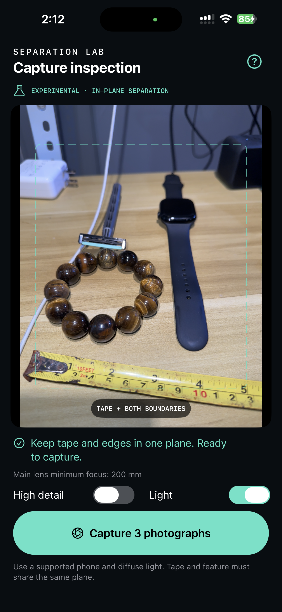
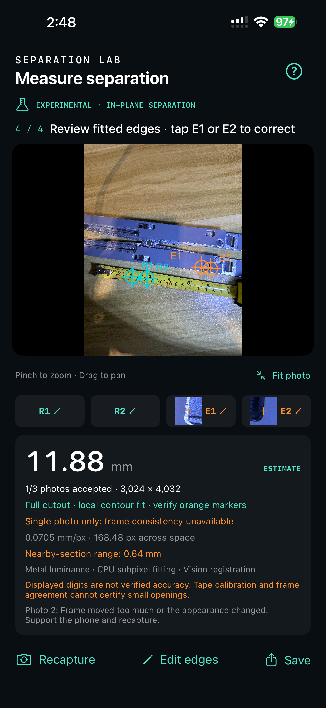
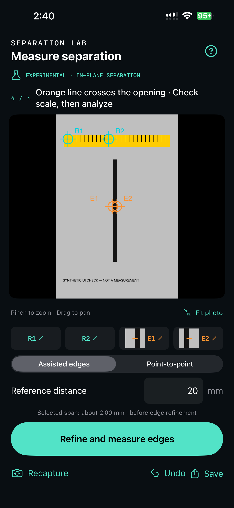

# Separation Lab

**Experimental iPhone app for investigating camera-based material separation and cutout-width measurements.**

> **EXPERIMENT — NEEDS MORE WORK — ON HOLD**  
> Development is paused because suitable reference-measurement equipment is unavailable. Accuracy, minimum measurable opening, and field repeatability have **not** been established. Results must not be used for production acceptance or precision-metrology claims.

Separation Lab explores whether an iPhone can help employees capture, calibrate, and document visible distances between material boundaries. It combines guided capture, manually selected reference markings, subpixel boundary processing, and multi-photo consistency checks. The initial hardware baseline is **iPhone 14 Pro Max**; broader device qualification is unfinished.

## Pictures

| Guided capture | Real cutout experiment | Synthetic workflow check |
| --- | --- | --- |
|  |  |  |

The real cutout screenshot shows **11.88 mm**, but only **1 of 3 photos** passed and nearby sections spanned **0.64 mm**. There is no independent reference value. Displayed digits do not establish accuracy. The synthetic example checks implementation behavior, not physical accuracy.

## Prototype capabilities

- Three original-resolution photographs from the physical main camera, with standard/high-detail selection.
- Basic brightness, autofocus, stability, and thermal guidance; optional phone light.
- Focus, exposure, and white-balance locking during the sequence.
- Zoomable photo inspection with two reference points and two material-boundary points.
- Editable R1/R2/E1/E2 controls, magnified edge crops, a keypad Done button, and Fit photo.
- **Assisted edges:** jointly fits blurred boundaries with separate surface brightness levels.
- **Full cutout:** independently refines selected outer contours when internal tabs or texture prevent an empty-opening model from fitting.
- **Point-to-point:** explicitly labelled manual estimation, without automatic edge verification.
- Metal luminance processing with CPU fallback; CPU numerical fitting; Vision global translation registration followed by local tracking.
- Local evidence export, including originals and selection metadata, even when fitting fails.

## Important limitations

- **No validated accuracy specification.** Subpixel positions and decimal places do not prove physical precision.
- **Two-point scalar calibration only.** Reference and feature must share a plane and approximately face the camera. Full perspective and lens-distortion correction are unfinished.
- **Boundary ambiguity:** shadows, reflections, rounded corners, bevels, and internal parts can produce different apparent contours. Orange markers require review.
- **Tracking is incomplete.** Real captures can reject two of three photos. One accepted photo does not establish repeatability.
- **Visible in-plane distances only.** Hidden clearances, material thickness, and surface height/flush differences are not implemented or validated.
- **LiDAR is not a dimensional reference here.** No trained neural boundary model is included. This is not a full reproduction of the paper's trained, calibrated multi-view regression pipeline.
- Numerical fixtures and limited exploratory captures are not a metrological qualification.

See [validation status and restart plan](docs/VALIDATION.md) for the evidence and next experiments.

## Build and run

1. Open `SeparationLab.xcodeproj` in Xcode on macOS. The last verified build used Xcode 27.1; the deployment target is iOS 17.0.
2. Select your Apple development team under **Signing & Capabilities**. Change the bundle identifier if needed. Account-specific signing values are not committed.
3. Connect an iPhone, enable Developer Mode, and run the `SeparationLab` scheme. Grant camera access.

The generated project is included. After changing `project.yml`, regenerate it with [XcodeGen](https://github.com/yonaskolb/XcodeGen):

```sh
xcodegen generate
```

Run the numerical checks on macOS:

```sh
bash scripts/check-measurement.sh
```

The script compiles measurement and registration logic and runs **22 checks** using Swift and Vision. It needs no connected phone and does not verify physical accuracy.

## Capture workflow

1. Support the phone and use diffuse lighting. Put the scale reference beside the feature, in the same plane.
2. Capture three photos while holding steady. Begin with standard detail.
3. Zoom in and select two actual scale markings. Enter their separation in millimetres and tap **Done**. For example, 5 cm to 7 cm is **20 mm**.
4. Select the two intended boundaries across the opening. For a partly occupied cutout, enable **Full cutout · ignore interior tab**.
5. Refine and measure. Inspect the orange markers; use E1/E2 to correct either boundary without repeating calibration.
6. Review accepted-photo count and section/frame variation. Save evidence rather than treating a number as a verified tolerance decision.

## Data and privacy

Images are processed locally. No analytics, cloud upload, or server dependency is included. The latest real capture is retained in Documents/LatestCapture inside the app; a new capture replaces it. Exports are shared through the user's share-sheet action. Repository screenshots document the experiment; full original inspection bundles are not included.

## Needs more work

- [ ] Obtain reference-measured features and suitable calibration equipment.
- [ ] Establish bias, repeatability, error distribution, and failure rate on physical samples.
- [ ] Improve capture geometry, scale calibration, perspective correction, and distortion handling.
- [ ] Improve multi-photo tracking and failure diagnostics.
- [ ] Resolve rim, bevel, reflection, and corner ambiguity.
- [ ] Validate minimum-width and accuracy claims separately for each mode.
- [ ] Evaluate fixtures, lighting, or optical accessories where necessary.
- [ ] Investigate surface offset and LiDAR-assisted positioning as separate experiments.
- [ ] Complete accessibility, broader device testing, and production engineering.


